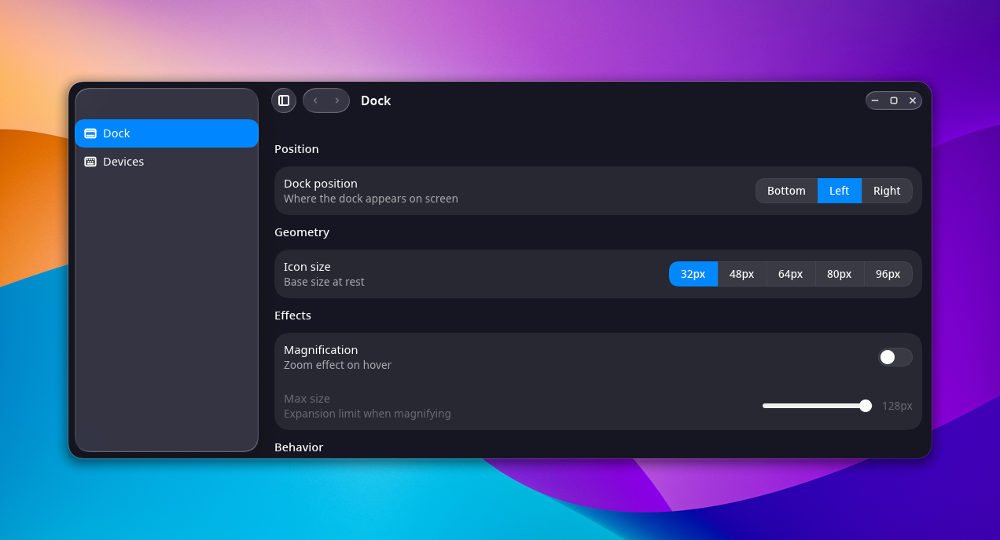
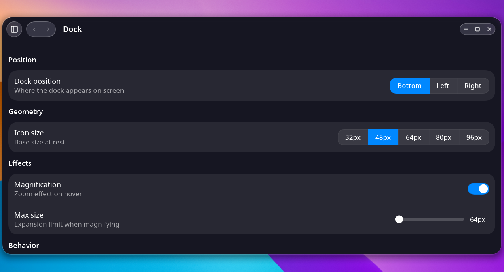
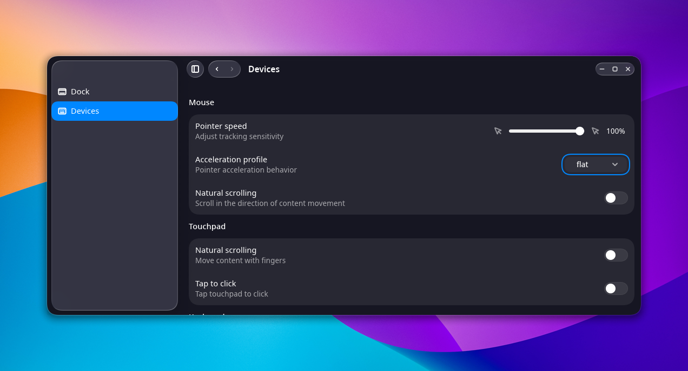
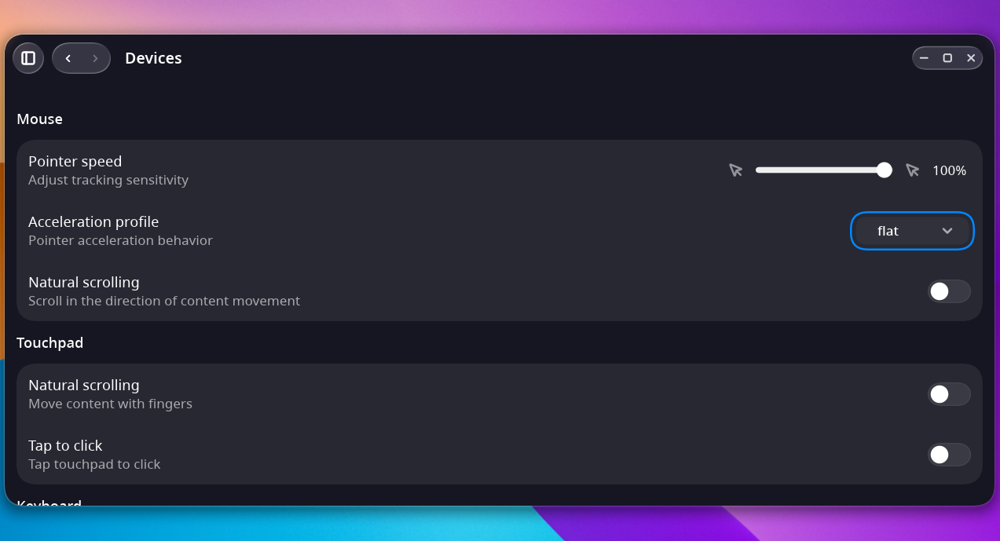

# AppWindow Settings, step 7a

These are private nested-Hyalo captures of the new, uninstalled window. The two
manifest pages are unchanged. **Dock uses metadata from the real private Rust
Config1 snapshot; Input uses nine explicit test keys in the private Config1
fixture. The real daemon does not yet expose those Input keys.** No TypeScript
fallback or installed-session/hardware claim is made.

Both scales exercised switch, segmented, preset, slider and dropdown writes,
canonical replies, menu invalidation by an external update, and a refused write's
row text. The writer's bus identity is checked by the fixture. At 1.25 the host's
narrow mode closes the sidebar after navigation; its button reopens it.

| Page | Scale 1 | Scale 1.25 |
|---|---|---|
| Dock |  |  |
| Input, fixture only |  |  |

Raw schemas, Apply traces, reader trees, failed setup attempts and unmodified PPMs
remain in the owner's local `evidence-1103-step7a` directory. No headless checker
or workflow was added to the repository. See [the entry point's scope](../../README.md).
